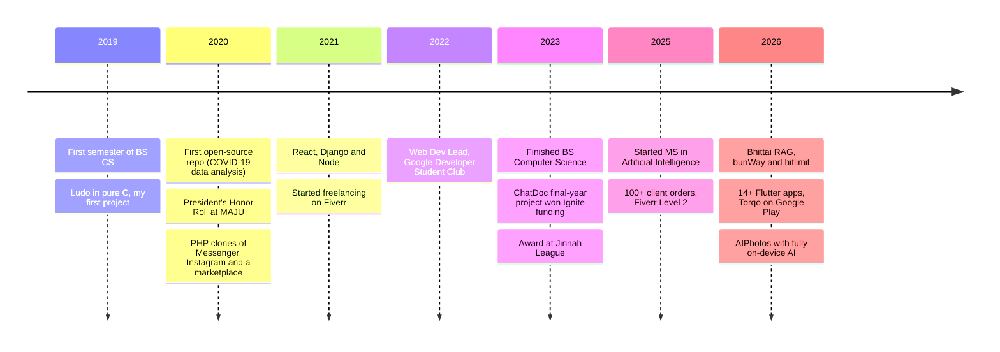

<p align="center">
  
</p>

<p align="center">
  
</p>

<p align="center">
  <a href="https://www.linkedin.com/in/muhammadrehanrasool/"></a>
  <a href="mailto:muhammadrehanrasool@gmail.com"></a>
  <a href="https://www.fiverr.com/rehan_sathio"></a>
  <a href="https://www.instagram.com/rehan.git/"></a>
  <a href="https://play.google.com/store/apps/details?id=com.kore.torqo"></a>
  
</p>

<p align="center">
  
  
  
  
  
</p>

I'm an **AI engineer** from Sindh, Pakistan, based in Karachi. I don't stay in one lane: in one month I might train a model, wire an LLM agent into a business workflow, write a framework for Bun, and ship a Flutter app to the Play Store. If something can be built, I like being the one who builds it end to end, from the data and the model to the API, the UI and the deployment.

```python
class Rehan:
    role         = "AI Engineer"
    based_in     = "Karachi, Pakistan"
    roots        = "Sindh"
    education    = ["BS Computer Science · MAJU · 2023",
                    "MS Artificial Intelligence · Bahria University · in progress"]
    builds       = ["LLM apps & agents", "ML / DL models", "document AI",
                    "mobile & on-device AI", "backends & frameworks",
                    "full-stack web", "scraping & automation"]
    gpu          = "RTX 3060 12GB (local models via Ollama + HF Transformers)"
    open_to      = ["full-time", "remote", "on-site in Karachi"]

    def motto(self) -> str:
        return "If I've done it twice by hand, I automate it."
```

## 🧰 What I build

> 🔓 = public repo or live link · 🔒 = private for now, going public soon

<table>
<tr>
<td valign="top" width="50%">

### 🤖 LLM apps, RAG & agents
- 🔓 **[Bhittai RAG](https://github.com/MuhammadRehanRasool/Bhittai-RAG-Neural-Retrieval-and-Semantic-Analysis-of-Shah-Jo-Risalo)** · [live](https://askbhittai.vercel.app): semantic search over Sufi poetry in Roman Sindhi with multilingual embeddings, FAISS, Gemini and a 51-query retrieval benchmark
- 🔒 **Invoice agent (n8n)**: Gmail/Drive → multimodal LLM extraction → human approval form → risk check → PostgreSQL. **85% faster** processing
- 🔒 **AI Social Circle**: Next.js + Gemini app that turns life logs into a 2D/3D relationship and trust graph
- 🔒 **CareerAI** and a **WhatsApp conversation bot**

</td>
<td valign="top" width="50%">

### 🧠 Machine learning & research
- 🔓 **[Trajectory Prediction](https://github.com/MuhammadRehanRasool/Relevance-Aware-Trajectory-Prediction-in-Dense-Urban-Environments)**: self-driving motion forecasting that prunes **52%** of the agent graph at the same accuracy (co-authored, paper submitted)
- 🔓 **[NeuroSymbolic Fraud Detection](https://github.com/MuhammadRehanRasool/NeuroSymbolic-AI-for-Explainable-Financial-Fraud-Detection-using-XGBoost)**: XGBoost + OWL 2 ontology with explainable verdicts, **92.86%** precision
- 🔓 **[Metaheuristic NN Optimizer](https://github.com/MuhammadRehanRasool/Neural-Network-Weight-Optimizer-using-Metaheuristic-Algorithms)**: trains networks without gradients, 8 algorithms vs. backprop
- 🔓 **[Stroke Risk Engine](https://github.com/MuhammadRehanRasool/Stroke-Prediction-using-Machine-Learning-and-Neural-Networks)**: 3-tier risk stratification, **92.37%** accuracy
- 🔒 Face recognition, clothing-image classifier (TensorFlow), property-price prediction, mental-health text classifier (group project)

</td>
</tr>
<tr>
<td valign="top" width="50%">

### 📄 Document AI & OCR
- 🔓 **[ReceiptLens](https://github.com/MuhammadRehanRasool/ReceiptLens-OCR-LLM)**: PaddleOCR → open-weight LLM → structured JSON, zero training
- 🔒 **Invoice parser**: pdfplumber + Tesseract fallback → Gemini → JSON and multi-sheet Excel with duplicate checks
- 🔒 **Doc Scanner app**: Flutter + ML Kit OCR with PDF export

</td>
<td valign="top" width="50%">

### 📱 Mobile & on-device AI
- 🔒 **AIPhotos** (Android, Java): EmbeddingGemma runs **fully on-device** for plain-language search over photos, recordings and video moments, plus automatic face grouping
- 🔓 **[Bahria LMS](https://bahria-lms.vercel.app)**: student app used by **118 students across 5 campuses**
- 🔒 **Mirror-Me**: AI virtual try-on built with Flutter Clean Architecture + BLoC, Gemini and Supabase RLS
- 🔓 **[Torqo](https://play.google.com/store/apps/details?id=com.kore.torqo)** on Google Play, one of **14+ Flutter apps**: AR drawing, QR scanner, expense manager, water tracker, converters…

</td>
</tr>
<tr>
<td valign="top" width="50%">

### ⚙️ Backends, frameworks & open source
- 🔓 **[bunWay](https://github.com/JointOps/bunway)**: Express-compatible framework for Bun with zero dependencies, 26 middleware and **2,423 tests**
- 🔓 **[hitlimit](https://github.com/JointOps/hitlimit-monorepo)**: rate limiting for Node and Bun with 8 storage backends at **5.5M+ ops/sec**
- 🔒 **Commodity trading platform**: matching engine, WebSockets, 38+ APIs, Stripe + Binance/TRC20, trading bots, CI/CD to a VPS

</td>
<td valign="top" width="50%">

### 🌐 Full-stack web
- **100+ client web apps** in Django, React, Next.js and Node: flight management, CRMs with live notifications, e-commerce fulfillment, a crypto exchange, exam-practice platforms, a media/publishing platform, multiplayer quiz games
- 🔒 **AI Golf Swing**: React 19 SPA with ~51 APIs, swing video upload, AI analysis and 3D skeleton views, plus coach review
- 🔓 **[AidFusion](https://github.com/MuhammadRehanRasool/AidFusion)**: donor/acceptor platform with verified accounts

</td>
</tr>
<tr>
<td valign="top" width="50%">

### 🕷️ Scraping & automation
- 🔒 **Maps Lead Generator**: a browser extension plus a desktop/CLI tool that scores leads and exports PDF reports
- 🔒 Zameen.pk real-estate scraper, LinkedIn jobs scraper, generic scraping framework, WeChat automation
- Workflows in **n8n, Make, Zapier, Selenium, Playwright and Puppeteer**

</td>
<td valign="top" width="50%">

### 🎨 Creative tools & dev tooling
- 🔓 **[Lofi Generator](https://github.com/MuhammadRehanRasool/lofi-generator)** and a 🔒 **music-generation dashboard** for creating, blending and exporting tracks
- 🔒 **Short-video generator**: script → TTS → short-form content
- 🔒 My own code generators (HTML→JSX, React Builder, CRUD page generator), Chrome extensions, npm packages
- 🔓 **[Archimaps](https://github.com/MuhammadRehanRasool/Archimaps-Clean-Folder-Structure-with-Token-Friendly-Prompt)**: AI prompt + scripts that reorganize messy workspaces

</td>
</tr>
</table>

## 🛠️ Toolbox

**Languages**
<br>

**AI / ML**
<br>
<br>


**Web & backend**
<br>

**Mobile**
<br>

**Data**
<br>

**DevOps & automation**
<br>
<br>


## 🛤️ The journey so far



<details>
  <summary><b>🗂️ Full project index (the long list)</b></summary>
  <br>

**AI / ML / research:** Bhittai RAG · Trajectory Prediction · NeuroSymbolic Fraud Detection · Metaheuristic NN Optimizer · Stroke Risk Engine · Depression Detection (group) · Face Recognizer · Clothing Image Classifier · Zameen price prediction · Photo → mood → Spotify playlist · ReceiptLens · Invoice parser · n8n invoice agent · AI Social Circle · CareerAI · ChatDoc (patient-intake chatbot, BS final-year project) · NLP key-phrase highlighter on my portfolio site

**Mobile:** AIPhotos · Mirror-Me · Bahria LMS · Torqo · AR Drawing · Doc Scanner OCR · QR/Barcode Scanner · Expense Manager · Water Tracker · Smart Converter · Text & Notes Utility · Daily Quote · NameSwipe · Pet Names · Clicker Game · Hangman · Dino Run · Tic-Tac-Toe

**Backend & open source:** bunWay · hitlimit · Commodity trading platform · Django Channels live notifications · Socket.IO and Python socket servers · Instagram REST wrapper · npm packages (neonizer, native-greetings)

**Full-stack web:** AI Golf Swing · Media publishing platform · AidFusion · Flight management systems · CRMs · E-commerce fulfillment · Crypto exchange · Load board · Exam and past-paper practice · Math-learning app · Games website (quiz, blackjack, "who is lying") · Medical-data portal · Resume builders · Chat apps · Calendar app · OpenCart store · Roami travel app

**Scraping & automation:** Maps Lead Generator (extension + desktop) · Google Maps scraper · Zameen.pk scraper · LinkedIn jobs scraper · Generic scraper framework · Email extractor · WeChat automation · WhatsApp bot

**Creative & tooling:** Lofi Generator · YouTube music generator · Short-video generator · Article generator · Cards generator · HTML→JSX converter · React Builder · CRUD page generator · Figma color plugin · Chrome extensions · Archimaps · ScreenSync

**Where it started:** [Ludo in C](https://github.com/MuhammadRehanRasool/ludo-c-terminal) · [COVID-19 analysis](https://github.com/MuhammadRehanRasool/Covid19-Project) · [Messenger clone](https://github.com/MuhammadRehanRasool/messenger-clone) · [Instagram clone](https://github.com/MuhammadRehanRasool/instagram-clone)

</details>

<details>
  <summary><b>🏅 Recognition & community</b></summary>
  <br>

- Web Dev Lead, Google Developer Student Club (MAJU), 2022–23
- Ignite funding for **ChatDoc**, my BS final-year project
- President's Honor Roll, Mohammad Ali Jinnah University, Spring 2020
- Award on stage at Jinnah League 2023
- Speaker at a MAJULancer freelancing awareness session
- ACM MAJU "Code Heist Pro" competitive coding, 2022
- Regular at Karachi AI meetups

</details>

<details>
  <summary><b>📈 GitHub stats</b></summary>
  <br>
  <p align="center">
    
    
  </p>
</details>

<p align="center"><b>Have something that needs building?</b> <a href="mailto:muhammadrehanrasool@gmail.com">Email me</a> or find me on <a href="https://www.linkedin.com/in/muhammadrehanrasool/">LinkedIn</a>.</p>

<p align="center">
  
</p>
